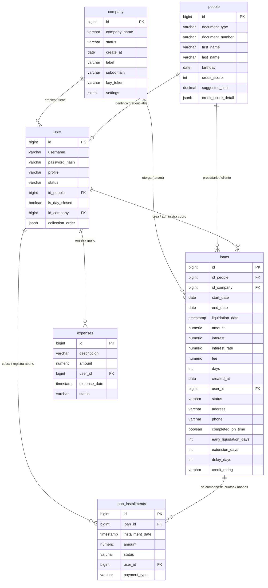

# Catálogo de Base de Datos y Diagrama ER - NeoCobros Pro

> **Fuente de Verdad Arquitectónica de Datos**  
> Proyecto: `PrestamosApi` (Backend NestJS + TypeORM + PostgreSQL)  
> Última sincronización: 22 de Octubre de 2026

---

## 1. Diagrama Entidad - Relación (ERD)



---

## 2. Catálogo Detallado de Tablas

### 2.1 Tabla: `company` (Empresas / Tenants SaaS)
**Entidad TypeORM:** [`CompanyEntity`](../src/companies/infrastructure/repositories/entities/company.entity.ts)  
Representa a cada organización o empresa cliente dentro del modelo SaaS multi-tenant.

| Columna | Tipo PostgreSQL | Nulidad | Clave / Restricción | Default | Descripción |
| :--- | :--- | :--- | :--- | :--- | :--- |
| `id` | `BIGINT` | `NOT NULL` | **PK** (Autoincrement) | `nextval()` | Identificador único de la empresa. |
| `company_name` | `VARCHAR` | `NULL` | | `NULL` | Razón social o nombre comercial de la empresa. |
| `status` | `VARCHAR(10)` | `NOT NULL` | | `'ACTIVE'` | Estado de la empresa (`ACTIVE`, `INACTIVE`). |
| `create_at` | `DATE` | `NOT NULL` | | `CURRENT_DATE` | Fecha de creación del tenant en la plataforma. |
| `label` | `VARCHAR` | `NULL` | | `NULL` | Etiqueta o identificador comercial visible para uso humano (ej: "Sede Norte"). |
| `subdomain` | `VARCHAR` | `NULL` | **UNIQUE / INDEX** | `NULL` | Subdominio web para acceso SaaS (`nombreEmpresa.neocobros.com`). |
| `key_token` | `VARCHAR(64)` | `NOT NULL` | **UNIQUE / INDEX** | | Llave criptográfica secreta del tenant (ej: `cmp_a8f29c41d7e0b583`). Se sella en el JWT para validación por Clave Compuesta y actúa como *Kill-Switch* instantáneo. |
| `settings` | `JSONB` | `NOT NULL` | | `'{}'::jsonb` | Configuración granular del tenant (flags de módulos opcionales como `risk_scoring`, preferencias de crédito, etc.). |

#### Estructura del JSONB `company.settings`:
```json
{
  "features": {
    "risk_scoring": true,             // Habilita la evaluación previa de Central de Riesgos en el registro de préstamos
    "customer_report": true           // Habilita el reporte integral de salud crediticia por cliente
  },
  "branding": {
    "primaryColor": "#4147eb",        // Color primario del sistema (botones, enlaces, badges)
    "secondaryColor": "#100069",      // Color secundario / fondo oscuro
    "iconUrl": "data:image/png;base64,..." // Isotipo / ícono personalizado por tenant para sidebar y favicon
  },
  "loans": {
    "defaultDays": 24,                // Días predeterminados de plazo de cobro
    "defaultInterestRate": 20,        // Tasa de interés base en % (ej. 20%)
    "allowCollectorOverrideOver1000": true // Flag a demanda: autoriza a cobradores a modificar plazo en montos >= S/ 1,000
  }
}
```

#### Script SQL DDL de Migración para `company`:
```sql
-- 1. Agregar columna settings
ALTER TABLE company 
  ADD COLUMN IF NOT EXISTS settings JSONB NOT NULL DEFAULT '{}'::jsonb;

-- 2. Agregar columna key_token
ALTER TABLE company 
  ADD COLUMN IF NOT EXISTS key_token VARCHAR(64) NULL;

-- 3. Backfill para empresas existentes
UPDATE company 
SET key_token = 'cmp_' || md5(random()::text || clock_timestamp()::text) 
WHERE key_token IS NULL;

-- 4. Restricción NOT NULL y UNIQUE
ALTER TABLE company ALTER COLUMN key_token SET NOT NULL;
ALTER TABLE company ADD CONSTRAINT uq_company_key_token UNIQUE (key_token);

COMMENT ON COLUMN company.key_token IS 'Llave criptográfica secreta del tenant para validación compuesta y Kill-Switch';
COMMENT ON COLUMN company.settings IS 'Configuración granular del tenant (flags de módulos, scoring, defaults)';
```

---

### 2.2 Tabla: `people` (Personas / Clientes / Colaboradores)
**Entidad TypeORM:** [`PersonEntity`](../src/users/infrastructure/repositories/entities/person.entity.ts)  
Almacena los datos personales civiles de prestatarios (clientes finales) y colaboradores antes de vincular usuario o préstamo.

| Columna | Tipo PostgreSQL | Nulidad | Clave / Restricción | Default | Descripción |
| :--- | :--- | :--- | :--- | :--- | :--- |
| `id` | `BIGINT` | `NOT NULL` | **PK** (Autoincrement) | `nextval()` | Identificador único de la persona. |
| `document_type` | `VARCHAR(3)` | `NOT NULL` | | | Tipo de documento de identidad (`DNI`, `CE`, `RUC`). |
| `document_number` | `VARCHAR(15)` | `NOT NULL` | **INDEX** | | Número de documento de identidad. |
| `first_name` | `VARCHAR(50)` | `NOT NULL` | | | Nombres de la persona. |
| `last_name` | `VARCHAR(50)` | `NOT NULL` | | | Apellidos de la persona. |
| `birthday` | `DATE` | `NULL` | | `NULL` | Fecha de nacimiento de la persona. |
| `credit_score` | `INT` | `NOT NULL` | | `100` | Score o puntaje de salud crediticia global (0 a 100). |
| `credit_score_detail` | `JSONB` | `NULL` | | `NULL` | Desglose explicativo de los 3 pilares del scoring y métricas de soporte (ver estructura detallada abajo). |
| `suggested_limit` | `DECIMAL(10,2)` | `NULL` | | `NULL` | Reservado para futuras fases (permanece en `NULL` y no se muestra en el análisis de crédito). |

#### Estructura del JSONB `people.credit_score_detail`:
```json
{
  "calculated_at": "TIMESTAMP ISO8601 (ej. '2026-10-23T01:00:00.000Z')",
  "score": 85,
  "rating": "A",
  "rating_label": "Bueno / Riesgo Bajo",
  "summary": {
    "total_loans_count": 6,
    "liquidated_count": 5,
    "active_count": 1,
    "active_tenants_count": 1,
    "has_arrears": false,
    "total_debt_amount": 1200.00,
    "total_paid_amount": 7500.00
  },
  "pillars": {
    "reputation_history": {
      "score": 25,
      "max_score": 40,
      "weight_percent": 40,
      "liquidated_on_time_count": 3,
      "early_liquidated_count": 1,
      "liquidated_with_extension_count": 2,
      "avg_delay_days": 1.5,
      "is_new_customer": false,
      "assessment": "Historial positivo con cancelaciones totales"
    },
    "active_punctuality": {
      "score": 45,
      "max_score": 45,
      "weight_percent": 45,
      "active_delay_days": 0,
      "unpaid_installments_count": 0,
      "status": "AL_DIA",
      "assessment": "100% puntual en cuotas vigentes"
    },
    "debt_capacity": {
      "score": 15,
      "max_score": 15,
      "weight_percent": 15,
      "active_loans_count": 1,
      "active_tenants_count": 1,
      "has_cross_tenant_arrears": false,
      "status": "OPTIMO",
      "assessment": "Capacidad de endeudamiento saludable"
    }
  },
  "recommendations": {
    "status": "APROBADO",
    "suggested_action": "Cliente apto para renovación estándar o ampliación de monto.",
    "risk_level": "BAJO"
  }
}
```

---

### 2.3 Tabla: `user` (Usuarios del Sistema)
**Entidad TypeORM:** [`UserEntity`](../src/users/infrastructure/repositories/entities/user.entity.ts)  
Gestiona las credenciales de autenticación, roles y pertenencia a empresa para el personal del sistema (Administradores, Cobradores, Supervisores).

| Columna | Tipo PostgreSQL | Nulidad | Clave / Restricción | Default | Descripción |
| :--- | :--- | :--- | :--- | :--- | :--- |
| `id` | `BIGINT` | `NOT NULL` | **PK** (Autoincrement) | `nextval()` | Identificador único del usuario. |
| `username` | `VARCHAR(50)` | `NOT NULL` | **INDEX** | | Nombre de usuario o identificador de inicio de sesión. |
| `password_hash` | `VARCHAR(255)` | `NOT NULL` | | | Contraseña hasheada (bcrypt). |
| `profile` | `VARCHAR(20)` | `NOT NULL` | | | Rol de usuario (`OWNER`, `ADMIN`, `COBRADOR`). El `OWNER` es el Superadmin de la plataforma. |
| `status` | `VARCHAR(10)` | `NOT NULL` | | | Estado de la cuenta (`ACTIVE`, `INACTIVE`, etc.). |
| `id_people` | `BIGINT` | `NOT NULL` | **FK** -> `people.id` | | Vinculación a la persona titular de la cuenta. |
| `is_day_closed` | `BOOLEAN` | `NOT NULL` | | `false` | Indica si el cobrador realizó su cierre diario de caja. |
| `id_company` | `BIGINT` | `NULL` | **FK** -> `company.id` | `NULL` | Tenant/empresa a la que pertenece el usuario. En el caso del `OWNER`, es `0` o `NULL` (administrador transversal sin tenant cliente). |
| `collection_order` | `JSONB` | `NULL` | | `NULL` | Array JSON con los IDs de préstamos para ordenar su ruta de cobro. |

---

### 2.4 Tabla: `loans` (Préstamos Financieros)
**Entidad TypeORM:** [`LoanEntity`](../src/loans/infrastructure/repositories/entities/loan.entity.ts)  
Registro central de cada operación crediticia otorgada a un cliente.

| Columna | Tipo PostgreSQL | Nulidad | Clave / Restricción | Default | Descripción |
| :--- | :--- | :--- | :--- | :--- | :--- |
| `id` | `BIGINT` | `NOT NULL` | **PK** (Autoincrement) | `nextval()` | Identificador único del préstamo. |
| `id_people` | `BIGINT` | `NOT NULL` | **FK** -> `people.id` | | Cliente titular del préstamo. |
| `id_company` | `BIGINT` | `NULL` | **FK** -> `company.id` | `NULL` | Empresa / Tenant dueña del préstamo. |
| `start_date` | `DATE` | `NOT NULL` | | | Fecha de inicio / desembolso del préstamo. |
| `end_date` | `DATE` | `NOT NULL` | | | Fecha estimada de término / última cuota. |
| `liquidation_date` | `TIMESTAMP` | `NULL` | | `NULL` | Fecha y hora exacta en que el préstamo fue liquidado al 100%. |
| `amount` | `NUMERIC(12,2)` | `NOT NULL` | | | Capital prestado (monto neto desembolsado). |
| `interest` | `NUMERIC(12,2)` | `NOT NULL` | | | Monto monetario total del interés generado. |
| `interest_rate` | `NUMERIC(5,2)` | `NOT NULL` | | `20.00` | Porcentaje de interés (%) pactado al momento de otorgar el crédito. |
| `fee` | `NUMERIC(12,2)` | `NOT NULL` | | | Valor nominal de cada cuota regular periódica. |
| `days` | `INT` | `NOT NULL` | | `24` | Cantidad total de cuotas / días programados. |
| `created_at` | `DATE` | `NOT NULL` | | `CURRENT_DATE` | Fecha de registro del crédito en el sistema. |
| `user_id` | `BIGINT` | `NOT NULL` | **FK** -> `user.id` | | Cobrador o usuario asignado a la gestión del préstamo. |
| `status` | `VARCHAR(15)` | `NOT NULL` | | `'Activo'` | Estado del préstamo (`Activo`, `Liquidado`, `Eliminado`). |
| `address` | `VARCHAR(255)` | `NULL` | | `NULL` | Dirección o domicilio asociado para la cobranza. |
| `phone` | `VARCHAR(20)` | `NOT NULL` | | `''` | Teléfono de contacto directo del cliente. |
| `completed_on_time` | `BOOLEAN` | `NOT NULL` | | `false` | Indica si el crédito liquidó en fecha pactada o antes (`extension_days === 0`). |
| `early_liquidation_days` | `INT` | `NOT NULL` | | `0` | Días hábiles de anticipación con que canceló el crédito antes del vencimiento. |
| `extension_days` | `INT` | `NOT NULL` | | `0` | Días hábiles de prórroga transcurridos fuera del plazo contractual pactado. |
| `delay_days` | `INT` | `NOT NULL` | | `0` | Días hábiles del cronograma que estuvieron impagos (evaluados hasta la liquidación). |
| `credit_rating` | `VARCHAR(5)` | `NULL` | | `NULL` | Calificación crediticia final del préstamo (`A+`, `A`, `B`, `C`). |

---

### 2.5 Tabla: `loan_installments` (Abonos y Cuotas Pagadas)
**Entidad TypeORM:** [`LoanInstallmentEntity`](../src/loans/infrastructure/repositories/entities/loan-installment.entity.ts)  
Historial transaccional de pagos y amortizaciones aplicadas a un préstamo.

| Columna | Tipo PostgreSQL | Nulidad | Clave / Restricción | Default | Descripción |
| :--- | :--- | :--- | :--- | :--- | :--- |
| `id` | `BIGINT` | `NOT NULL` | **PK** (Autoincrement) | `nextval()` | Identificador único del abono. |
| `loan_id` | `BIGINT` | `NOT NULL` | **FK** -> `loans.id` | | Préstamo al que se aplica el pago. |
| `installment_date` | `TIMESTAMP` | `NOT NULL` | | `CURRENT_TIMESTAMP` | Fecha y hora en que se registró el abono. |
| `amount` | `NUMERIC(12,2)` | `NOT NULL` | | | Monto amortizado en esta transacción. |
| `status` | `VARCHAR(15)` | `NOT NULL` | | `'PAID'` | Estado del abono (`PAID`). |
| `user_id` | `BIGINT` | `NOT NULL` | **FK** -> `user.id` | | Cobrador o usuario que recibió y procesó el dinero. |
| `payment_type` | `VARCHAR(10)` | `NULL` | | `NULL` | Medio de pago utilizado (`EFECTIVO`, `YAPE`, `TRANSFERENCIA`). |

---

### 2.6 Tabla: `expenses` (Gastos Operativos de Ruta)
**Entidad TypeORM:** [`ExpenseEntity`](../src/expenses/infrastructure/repositories/entities/expense.entity.ts)  
Registro de egresos operativos diarios incurridos por el cobrador en ruta (gasolina, viáticos, mantenimiento).

| Columna | Tipo PostgreSQL | Nulidad | Clave / Restricción | Default | Descripción |
| :--- | :--- | :--- | :--- | :--- | :--- |
| `id` | `BIGINT` | `NOT NULL` | **PK** (Autoincrement) | `nextval()` | Identificador único del gasto. |
| `descripcion` | `VARCHAR(200)` | `NOT NULL` | | | Detalle o motivo del gasto reportado. |
| `amount` | `NUMERIC(12,2)` | `NOT NULL` | | | Importe desembolsado en el gasto. |
| `user_id` | `BIGINT` | `NOT NULL` | **FK** -> `user.id` | | Cobrador o usuario que realizó el gasto. |
| `expense_date` | `TIMESTAMP` | `NOT NULL` | | | Fecha y hora en que se efectuó el gasto. |
| `status` | `VARCHAR(15)` | `NOT NULL` | | | Estado del registro de gasto (`ACTIVE`, `VOID`). |

---

### 2.6 Tabla: `cron_executions` (Auditoría de Crons y Cierres Masivos)
**Entidad TypeORM:** [`CronExecutionEntity`](../src/loans/infrastructure/repositories/entities/cron-execution.entity.ts)  
Registra la auditoría y trazabilidad de cada ejecución de tareas programadas masivas (cierre diario de cartera y evaluación de mora), sean automáticas (23:00) o a demanda por el perfil OWNER.

| Columna | Tipo PostgreSQL | Nulidad | Clave / Restricción | Default | Descripción |
| :--- | :--- | :--- | :--- | :--- | :--- |
| `id` | `BIGSERIAL` | `NOT NULL` | **PK** (Autoincrement) | `nextval()` | Identificador único de la ejecución. |
| `job_name` | `VARCHAR(100)` | `NOT NULL` | | | Nombre de la tarea (ej: `DAILY_LOANS_CLOSING`). |
| `trigger_type` | `VARCHAR(20)` | `NOT NULL` | | `'SCHEDULED'` | Origen del disparo (`SCHEDULED` o `MANUAL`). |
| `status` | `VARCHAR(20)` | `NOT NULL` | | | Estado de la ejecución (`RUNNING`, `SUCCESS`, `FAILED`). |
| `started_at` | `TIMESTAMP WITH TIME ZONE` | `NOT NULL` | | `CURRENT_TIMESTAMP` | Fecha y hora de inicio. |
| `finished_at` | `TIMESTAMP WITH TIME ZONE` | `NULL` | | `NULL` | Fecha y hora de culminación. |
| `duration_ms` | `INT` | `NULL` | | `NULL` | Tiempo transcurrido en milisegundos. |
| `liquidated_processed` | `INT` | `NULL` | | `0` | Préstamos liquidados consolidados. |
| `active_processed` | `INT` | `NULL` | | `0` | Préstamos activos evaluados. |
| `total_processed` | `INT` | `NULL` | | `0` | Suma de registros actualizados. |
| `error_message` | `TEXT` | `NULL` | | `NULL` | Traza del mensaje en caso de fallo. |
| `details` | `JSONB` | `NULL` | | `NULL` | Datos complementarios de la ejecución. |

#### Script SQL DDL de Creación:
```sql
CREATE TABLE IF NOT EXISTS cron_executions (
  id BIGSERIAL PRIMARY KEY,
  job_name VARCHAR(100) NOT NULL,
  trigger_type VARCHAR(20) NOT NULL DEFAULT 'SCHEDULED',
  status VARCHAR(20) NOT NULL,
  started_at TIMESTAMP WITH TIME ZONE NOT NULL DEFAULT CURRENT_TIMESTAMP,
  finished_at TIMESTAMP WITH TIME ZONE NULL,
  duration_ms INT NULL,
  liquidated_processed INT DEFAULT 0,
  active_processed INT DEFAULT 0,
  total_processed INT DEFAULT 0,
  error_message TEXT NULL,
  details JSONB NULL
);

CREATE INDEX IF NOT EXISTS idx_cron_executions_started_at ON cron_executions(started_at DESC);
```

---

## 3. Reglas de Integridad y Convenciones Técnicas

1. **Precisión de Identificadores (`BIGINT` como `string`):**  
   Todas las claves primarias y foráneas numéricas son de tipo `BIGINT` en PostgreSQL y se mapean como `string` en TypeScript para prevenir problemas de desbordamiento de enteros (Safe Integer Limit de JavaScript: $2^{53} - 1$).
2. **Aislamiento Multi-Tenant:**  
   Las tablas `user` y `loans` contienen `id_company` para garantizar que las consultas filtren estrictamente los datos de la empresa correspondiente al subdominio activo.
3. **Cálculos Financieros:**  
   - `Total a Pagar` = `loans.amount` + `loans.interest`
   - `Saldo Pendiente` = `(loans.amount + loans.interest)` - `SUM(loan_installments.amount WHERE status = 'ACTIVE')`
   - `Estado Liquidado` = Cuando `Saldo Pendiente <= 0` o `loans.status = 'Liquidado'`, asignando `loans.liquidation_date = CURRENT_TIMESTAMP`.
4. **Soft Delete / Estados:**  
   Los préstamos y abonos manejan estados (`loans.status != 'Eliminado'`) para preservar trazabilidad contable y auditoría histórica.
5. **Tratamiento de Domingos y Días Hábiles:**  
   - La columna `loans.days` representa **días hábiles laborables de cobro (lunes a sábado)**, excluyendo domingos.
   - La columna `loans.end_date` se calcula sumando `days` e incrementando automáticamente por cada domingo intermedio.
   - En consultas de mora y scoring (`credit-score-cron.service.ts`), los días vencidos se calculan en PostgreSQL mediante:
     $$\text{workdays} = (\text{CURRENT\_DATE} - \text{start\_date}) - \left\lfloor\frac{(\text{CURRENT\_DATE} - \text{start\_date}) + \text{DOW}(\text{start\_date})}{7}\right\rfloor$$
     garantizando que ningún domingo compute como día de retraso.
6. **Motor de Central de Riesgos (3 Pilares), Doble Ventana de Crons y Recálculo a Demanda:**  
   - **Central de Riesgos Global:** La tabla `people` es compartida por todos los tenants (representa a los ciudadanos por DNI). El `credit_score` (0 a 100) evalúa la salud crediticia global de la persona en todo el ecosistema.
   - **Estructura del Score en 3 Pilares:**
     $$\text{Score Total (100 pts)} = \text{Reputación Histórica (40 pts)} + \text{Puntualidad en Curso (45 pts)} + \text{Nivel de Endeudamiento (15 pts)}$$
     - *Pilar 1 (40 pts):* Basado en préstamos liquidados (`completed_on_time`, `early_liquidation_days`, `extension_days`, `delay_days`, `credit_rating`).
     - *Pilar 2 (45 pts):* Basado en la mora de préstamos activos al corte de hoy (`delay_days`).
     - *Pilar 3 (15 pts):* Basado en el número de préstamos activos simultáneos en distintas empresas y morosidad cruzada entre tenants.
   - **Modalidad Batch Nocturna (Doble Ventana de Crons):**
     - `23:00 (11:00 PM) - Cierre y Evaluación Financiera de Préstamos (DailyLoansClosingCron)`:  
       Evalúa de forma exhaustiva los préstamos de la base de datos (tanto activos como liquidados). Para los préstamos activos, compara las cuotas pagadas vs. días laborables exigibles (excluyendo domingos) y consolida los días de atraso (`delay_days`) al corte de hoy. Para los préstamos liquidados, verifica y consolida los días anticipados (`early_liquidation_days`), prórrogas (`extension_days`), cumplimiento (`completed_on_time`) y calificación (`credit_rating`). A partir de esto, precalcula y deja listos los agregados analíticos de los 3 pilares.
     - `01:00 (1:00 AM) - Actualizador de Scoring Global de Personas (CreditScoreCronService)`:  
       Proceso ultra liviano y rápido. Lee los indicadores consolidados a las 11:00 PM, aplica la ponderación matemática de los 3 pilares y actualiza directamente `credit_score` (0 a 100) y `credit_score_detail` (`JSONB`) en la tabla `people`. No itera sobre cuotas ni fechas en la madrugada.
   - **Modalidad On-Demand Individual (`POST /v1/people/:id/recalculate-score`):**  
     Permite que un asesor o administrador actualice al instante (< 15 ms) el score y los 3 pilares de un prestatario en particular directamente desde el modal de evaluación de crédito o ficha del cliente (útil tras abonos recientes o liquidaciones inmediatas).
