# NeoCobros - Flujos de Negocio y Diagramas de Secuencia (Workflows)

Este documento constituye la fuente de verdad arquitectónica sobre los procesos de negocio, interacciones entre capas y secuencias operativas implementadas en **NeoCobros** (`PrestamosApi` y `Prestamos`).

---

## Índice de Flujos de Negocio

1. [Autenticación y Resolución Multi-Tenant (SaaS Login)](#1-autenticación-y-resolución-multi-tenant-saas-login)
2. [Evaluación de Cliente y Otorgamiento de Préstamo](#2-evaluación-de-cliente-y-otorgamiento-de-préstamo)
3. [Cobranza en Ruta y Registro de Abonos (Liquidación Automática)](#3-cobranza-en-ruta-y-registro-de-abonos-liquidación-automática)
4. [Generación y Consulta Pública de Ficha de Préstamo (SaaS Link Cifrado)](#4-generación-y-consulta-pública-de-ficha-de-préstamo-saas-link-cifrado)
5. [Registro de Gastos Operativos de Ruta](#5-registro-de-gastos-operativos-de-ruta)
6. [Cierre Diario de Caja y Cuadre de Cobrador](#6-cierre-diario-de-caja-y-cuadre-de-cobrador)
7. [Reordenamiento Dinámico de la Ruta de Cobranza](#7-reordenamiento-dinámico-de-la-ruta-de-cobranza)
8. [Motor de Central de Riesgos: Doble Ventana de Crons y Recálculo a Demanda (On-Demand)](#8-motor-de-central-de-riesgos-doble-ventana-de-crons-y-recálculo-a-demanda-on-demand)
9. [Módulo de Reportes Financieros y Evolución del Capital e Inversión (MoM)](#9-módulo-de-reportes-financieros-y-evolución-del-capital-e-inversión-mom)
11. [Protección de Usuarios Demo contra Eliminación](#11-protección-de-usuarios-demo-contra-eliminación)

---

## 1. Autenticación y Resolución Multi-Tenant (SaaS Login)


Gestiona el acceso seguro aislando la información por cada empresa cliente (tenant) a través de su subdominio respectivo (`empresa.neocobros.com`).

### Diagrama de Secuencia

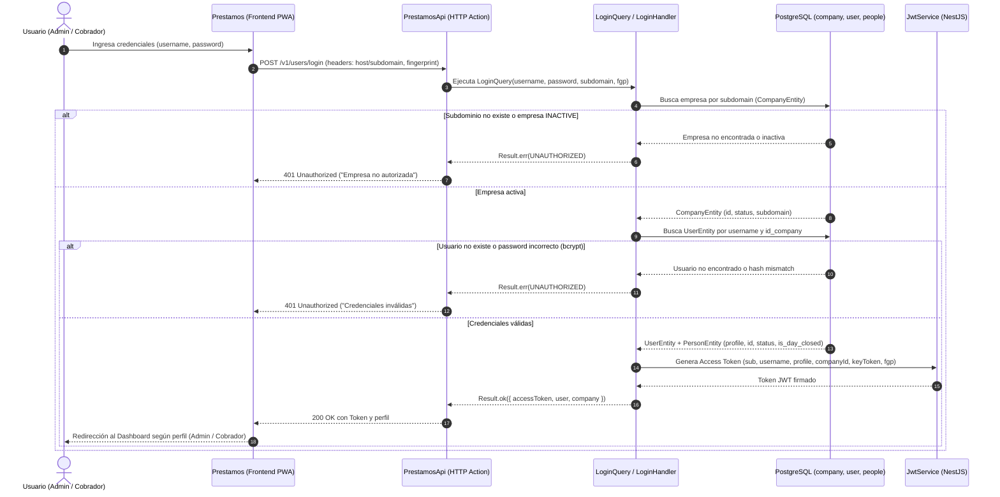

### Reglas Clave de Seguridad y Multi-Tenancy (Opción B: Clave Compuesta y Aceleración Redis)
- **Defensa por Clave Compuesta (*Composite Key Defense*):**
  - El token JWT sella dos valores inmutables del tenant: `companyId` y `keyToken` (ej: `cmp_a8f29c41d7e0b583`).
  - En cada petición protegida, el guard global [`JwtAuthGuard`](file:///d:/Personal/Repositorios/PrestamosApi/src/users/infrastructure/security/jwt-auth.guard.ts) verifica la clave compuesta con aceleración en **Redis**:
    - **Caché en RAM (`neocobros:tenant:auth:<companyId>`):** Latencia **$< 0.1 \text{ ms}$**, 0 conexiones a PostgreSQL.
    - **Cache Miss / Fallback:** Consulta directa a PostgreSQL:
      $$\text{WHERE } id = :companyId \text{ AND } key\_token = :keyToken \text{ AND } status = \text{'ACTIVE'}$$
      y almacena el resultado en Redis con TTL de 10 minutos (600s).
  - Un atacante que intente adivinar el ID correlativo de una empresa es incapaz de acertar el `key_token` aleatorio criptográfico (probabilidad $< 10^{-28}$).
- **Mecanismo de *Kill-Switch* Instantáneo:**
  - Si una empresa deja de pagar o se detecta una vulneración de credenciales, basta con regenerar su `key_token` en la base de datos o cambiar su estado a `SUSPENDED` / `INACTIVE`.
  - Los handlers de comando (`update-company-status.handler.ts` y `update-company.handler.ts`) invalidan automáticamente la clave `neocobros:tenant:auth:<companyId>` en Redis mediante `redis.del()`.
  - **En ese mismo milisegundo**, todas las sesiones activas de todos los cobradores y administradores de esa empresa quedan automáticamente invalidadas sin necesidad de reiniciar servidores.
- **Prevención de Suplantación (*Tenant Spoofing*):** No se utilizan cabeceras manuales en el cliente (como `x-tenant` o `x-company-id`).
- **Huella Digital del Dispositivo (`fgp`):** Se valida criptográficamente mediante el header `x-fingerprint` para garantizar que el token solo sea operado desde el dispositivo físico autorizado.
- **Acceso Maestro del Superadministrador (`OWNER` / `central.neocobros.com`):**
  - El subdominio `central` es el **Portal Maestro** de la plataforma NeoCobros.
  - En **Caddy**, `https://central.neocobros.com` cuenta con un registro fijo directo y su propio certificado, por lo que **no pasa por el microservicio de verificación ni por On-Demand TLS**. El microservicio `verifyDomain` y [`VerifyCompanyDomainHandler`](file:///d:/Personal/Repositorios/PrestamosApi/src/companies/application/queries/v1/handlers/verify-company-domain.handler.ts) están reservados exclusivamente para los subdominios dinámicos de los tenants cliente (`*.neocobros.com`).
  - El usuario con perfil `OWNER` tiene `id_company = 0` (o `null`), ya que **no pertenece a ningún tenant cliente**, sino que administra transversalmente todo el sistema (no requiere ni debe tener una fila ficticia en `company`).
  - **Bypass de Tenant en [`JwtAuthGuard`](file:///d:/Personal/Repositorios/PrestamosApi/src/users/infrastructure/security/jwt-auth.guard.ts):** Al detectar `profile === 'OWNER'` o `companyId === '0'`, el guard omite la validación de `keyToken` y Kill-Switch de tenant (evitando búsquedas erróneas de una empresa inexistente con ID 0) e inyecta una entidad virtual de `Company` con todas las features activas (`risk_scoring: true`) para permitir el acceso total.

### 🗄️ Convenciones de Redis y Separación Estricta de Namespaces

| Patrón de Clave | TTL | Responsabilidad / Consumidores | Regla de Oro Arquitectónica |
| :--- | :--- | :--- | :--- |
| `tenant:<domain>` | Indefinido / Permanente | **Ecosistema Multi-Proyecto:** Consumido por el reverse-proxy **Caddy** y el microservicio Go [`verifyDomain`](file:///d:/Personal/Repositorios/verifyDomain/README.md) para TLS On-Demand y autorización perimetral de subdominios. | **INMUTABLE (No Renombrar):** Nunca debe colocársele prefijos privados (como `neocobros:`), ya que múltiples proyectos y proxies (`neocobros.com`, `neoruta.com`) dependen de este formato exacto de clave. |
| `neocobros:tenant:auth:<companyId>` | 10 min (600s) | **Ecosistema Privado NeoCobros:** Consumido exclusivamente por [`JwtAuthGuard`](file:///d:/Personal/Repositorios/PrestamosApi/src/users/infrastructure/security/jwt-auth.guard.ts) para validar la sesión compuesta del tenant en microsegundos y habilitar el Kill-Switch instantáneo. | **ORGANIZADO EN CARPETAS:** Debe usar siempre la jerarquía `neocobros:tenant:auth:{id}` para no saturar la raíz de Redis y mantener orden en interfaces como RedisInsight. |

### 1.1 Arquitectura Perimetral y Validación de Subdominios (Caddy + verifyDomain)

El ecosistema NeoCobros opera con dos categorías estrictas de dominios perimetrales a nivel del proxy inverso **Caddy**:

#### A. Dominio Maestro Central (`https://central.neocobros.com` — Portal del OWNER)
* **Registro Fijo y Estático en Caddy:** Cuenta con una directiva de bloque de servidor explícita y dedicada en el `Caddyfile`.
* **Exención Absoluta de Microservicio:** **NO utiliza `on_demand_tls`** ni interactúa en ningún momento con el microservicio Go `verifyDomain`.
* **Cero Consulta a Redis y Cero Consulta a Base de Datos:** Caddy gestiona y renueva directamente su propio certificado SSL para `central.neocobros.com`.
* **Propósito y Aislamiento:** Es el portal administrativo exclusivo del Superadministrador del sistema (`OWNER`, con `id_company = 0` o `NULL`).
* **Regla de Diseño Mandatoria:** El endpoint de verificación de tenants en `PrestamosApi` (`/api/v1/company/verify-domain`) **no debe servir para que el microservicio consulte `central`**. En la base de datos de NeoCobros no existe ni debe existir una empresa cliente llamada `"central"` o con ID 0.

#### B. Subdominios Dinámicos de Tenants (`https://<empresa>.neocobros.com` — Empresas Cliente)
Para los subdominios de clientes, Caddy delega la autorización de certificados en tiempo real mediante la directriz perimetral `on_demand_tls`:

1. **Petición Entrante:** Caddy intercepta una conexión HTTPS hacia `https://<empresa>.neocobros.com`.
2. **Consulta al Microservicio (MS):** Caddy ejecuta una petición HTTP interna hacia el microservicio Go:  
   `GET http://verifydomain:3000/api/v1/tenants/verify-domain?domain=<empresa>.neocobros.com`
3. **Paso 1 — Consulta en Redis (`tenant:<subdominio>.<dominio>`):**
   * El microservicio Go consulta la clave por `subdominio.dominio`: `GET tenant:<empresa>.neocobros.com`.
   * **Cache Hit (Valor `"1"`):** Si la clave existe en Redis con valor `"1"`, `verifyDomain` responde `200 OK` en $< 1 \text{ ms}$. Caddy emite/sirve de inmediato el certificado SSL y enruta el tráfico hacia el Frontend.
4. **Paso 2 — Auto-Curación (*Self-Healing Fallback* a `PrestamosApi`):**
   * **Cache Miss (Clave no encontrada o nil):** Ocurre si la caché de Redis se reinició, se purgó o aún no se ha sincronizado la empresa.
   * En este caso, el microservicio `verifyDomain` identifica el sufijo `.neocobros.com` y consulta el endpoint de verificación de `PrestamosApi`:  
     `GET /api/v1/company/verify-domain?domain=<empresa>.neocobros.com`
   * [`VerifyCompanyDomainHandler`](file:///d:/Personal/Repositorios/PrestamosApi/src/companies/application/queries/v1/handlers/verify-company-domain.handler.ts) extrae el subdominio y consulta la tabla `company` en PostgreSQL:
     $$\text{SELECT * FROM company WHERE subdomain = :subdomain}$$
   * **Si la empresa existe y su estado es `ACTIVE`:**
     * `PrestamosApi` regenera y repuebla automáticamente la clave en Redis:
       $$\text{SET tenant:<empresa>.neocobros.com "1"}$$
     * `PrestamosApi` responde `200 OK {"verified": true}`.
     * `verifyDomain` recibe la confirmación, retorna `200 OK` a Caddy y se autoriza el apretón de manos SSL (*TLS handshake*) sin interrupción de servicio para los usuarios.
   * **Si la empresa no existe o está inactiva (`INACTIVE` / `SUSPENDED`):**
     * `PrestamosApi` responde `404 Not Found` o `403 Forbidden`.
     * `verifyDomain` responde `403 Forbidden {"verified": false, "error": "Dominio no registrado o inactivo"}`.
     * Caddy rechaza la solicitud de certificado SSL perimetralmente, impidiendo cualquier conexión hacia el tenant.

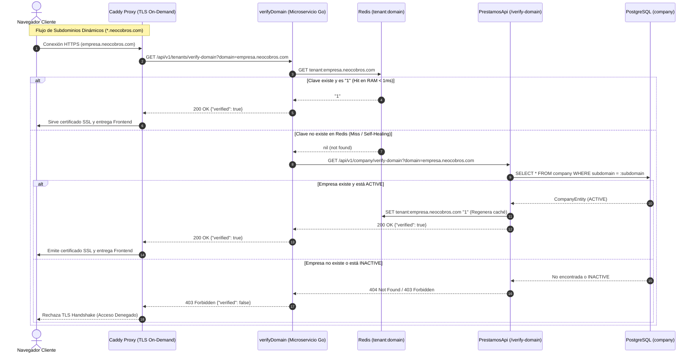

> [!IMPORTANT]
> **Por qué no se debe modificar la clave `tenant:<domain>`:**
> El microservicio [`verifyDomain`](file:///d:/Personal/Repositorios/verifyDomain/README.md) es un componente transversal de infraestructura. Inspecciona el sufijo del dominio: si termina en `.neocobros.com` consulta a `PrestamosApi`, pero si termina en `.neoruta.com` consulta a `VecturaApi`. Ambos sistemas comparten la misma instancia de Redis y el mismo contrato `tenant:<domain>`. Cambiar ese prefijo o agregar nombres privados (`neocobros:tenant:...`) desconectaría la auto-emisión de SSL para todos los proyectos del ecosistema.

### 1.2 Rotación Forzada de `key_token` y Kill-Switch Instantáneo de Tenant

Permite a los administradores centrales forzar la revocación inmediata de **todas** las sesiones activas de cobradores y administradores de una empresa específica ante pérdida de dispositivos, bajas de personal o emergencias de seguridad.

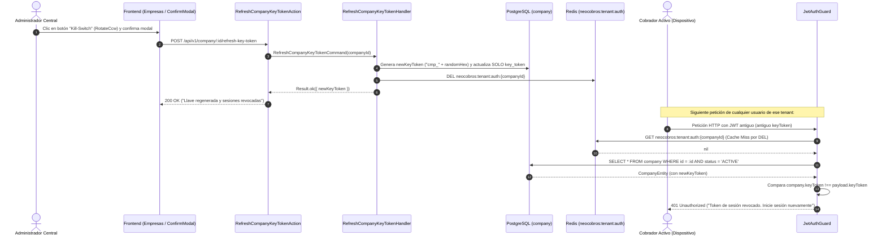

### 1.3 Mantenimiento Dinámico de Configuración de Empresa (`company.settings`)

La entidad `company` dispone de la columna `settings JSONB`, la cual administra flags funcionales y preferencias del tenant:
- **Endpoint:** `PUT /api/v1/company/:companyId` recibiendo `settings: { features: { risk_scoring: boolean }, ... }`.
- **Efecto de Caché:** El comando [`UpdateCompanyHandler`](file:///d:/Personal/Repositorios/PrestamosApi/src/companies/application/commands/v1/handlers/update-company.handler.ts) persiste `company.settings` e invalida automáticamente la caché `neocobros:tenant:auth:{companyId}` en Redis para que el cambio de permisos tome efecto de inmediato en el siguiente request de la empresa.
- **Frontend:** Administrado desde el modal [`CreateCompanyModal.tsx`](file:///d:/Personal/Repositorios/Prestamos/Prestamos/app/components/CreateCompanyModal.tsx) mediante un toggle switch para el módulo *Central de Riesgos & Scoring*.

---

## 2. Evaluación de Cliente y Otorgamiento de Préstamo

Permite registrar o vincular a un prestatario (`people`), calcular el cronograma de cuotas regular periódica (`fee`), fecha de vencimiento (`end_date`) y asignar el crédito a un cobrador.

### 2.1 Control de Módulos Opcionales por Tenant en el Backend (*Server-Side Feature Gating*)
El acceso a la **Central de Riesgos y Evaluación Crediticia** se administra y protege estrictamente en el Backend mediante la configuración:
```json
"company": {
  "settings": {
    "features": {
      "risk_scoring": true
    }
  }
}
```

* **Validación en Servidor (1 Sola Petición HTTP):** Al recibir `GET /api/v1/person/search`, el backend extrae `(companyId, keyToken)` del JWT verificado y consulta el registro de la empresa en la BD:
  * **Si `risk_scoring = true`:** El backend incluye en la respuesta `riskScoringEnabled: true` y entrega los objetos `creditScore` y `creditScoreDetail` en ese mismo viaje (< 20 ms).
  * **Si `risk_scoring = false` (o ausente):** El backend retorna `riskScoringEnabled: false` y **omite por completo** los datos de scoring (`creditScore` y `creditScoreDetail` quedan `undefined` / no expuestos).
* **Protección del Recálculo On-Demand:** Si una empresa no autorizada invoca `POST /api/v1/person/:id/recalculate-score`, el backend responde inmediatamente con **`403 Forbidden`** (*"Su empresa no tiene contratado el servicio de Central de Riesgos"*).
* **Comportamiento en Frontend:**
  * Si `riskScoringEnabled = false`: Transición directa e inmediata al formulario del préstamo (flujo directo tradicional).
  * Si `riskScoringEnabled = true`: Despliega el Paso 1.5 con la tarjeta de evaluación crediticia antes de solicitar las condiciones del crédito.

### 2.2 Diagrama de Secuencia: Creación de Préstamo con Evaluación de Riesgo

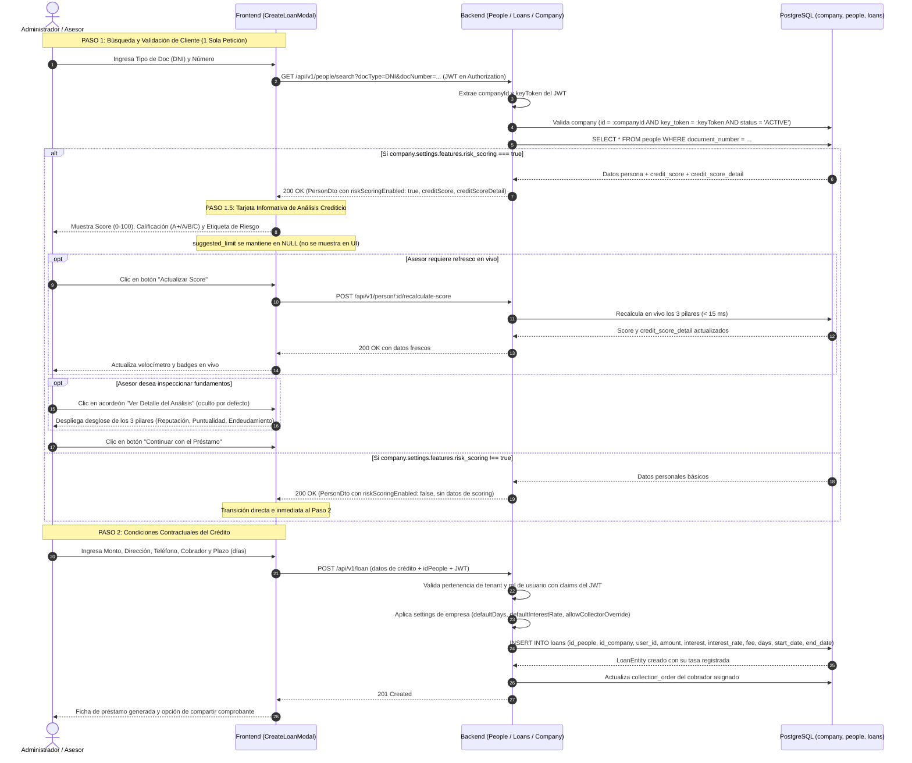

### 2.3 Reglas de la Pantalla de Análisis Crediticio (Paso 1.5)
1. **Naturaleza Informativa:** Esta pantalla es estrictamente de asesoría y toma de decisiones para el otorgante del crédito; no bloquea automáticamente el registro a menos que la empresa aplique sus propias políticas.
2. **Exclusión de `suggested_limit`:** La columna permanece en `NULL` en base de datos y **no se renderiza** en la interfaz para no condicionar montos sin validación comercial.
3. **Acordeón Oculto por Defecto:** Para mantener el modal ligero y ágil, el detalle minucioso de cuotas canceladas, promedio de días de atraso y compromisos cruzados inicia colapsado y solo se abre bajo demanda del usuario.
4. **Actualización Instantánea:** El botón "Actualizar Score" ejecuta el endpoint on-demand en < 15 ms para considerar pagos recibidos instantes antes en la calle.

### Tratamiento Especial de Domingos (Calendario Laborable de Lunes a Sábado)
En la actividad de cobranza diaria tradicional, **el domingo es día no laborable**. El sistema implementa las siguientes reglas estrictas de calendario:

1. **Fecha de Inicio (`startDate`):**
   - El préstamo inicia al día siguiente de su creación (`hoy + 1 día`).
   - Si el día siguiente resulta ser domingo (`startDate.getDay() === 0`), la fecha de inicio se traslada automáticamente al **lunes** (`+1 día adicional`).
2. **Fecha de Vencimiento (`endDate`):**
   - El parámetro `days` (mínimo 24 días) representa **días hábiles laborables de cobro**, NO días calendario.
   - El cálculo de `endDate` itera día por día saltando todos los domingos (`getDay() === 0`).
   - *Ejemplo práctico:* Un préstamo estándar de 24 días hábiles abarca 4 semanas completas: 24 días de cuota + 4 domingos de descanso = **28 días calendario totales**.
3. **Cálculo de Días Hábiles Transcurridos y Mora (Fórmula PostgreSQL en CPU):**
   - Para evaluar el atraso y el score crediticio sin penalizar los descansos dominicales, el backend calcula los días hábiles exigibles en $O(1)$:
     $$\text{workdays\_due} = \max\left(0, (\text{CURRENT\_DATE} - \text{start\_date}) - \left\lfloor\frac{(\text{CURRENT\_DATE} - \text{start\_date}) + \text{DOW}(\text{start\_date})}{7}\right\rfloor\right)$$
   - Los domingos transcurridos se descuentan del cómputo de mora; no se exige cuota ni se reduce puntaje crediticio si el cliente no abona en domingo.

---

## 3. Cobranza en Ruta y Registro de Abonos (Liquidación Automática)

El cobrador visita al cliente en su ruta diaria, cobra la cuota completa o un abono parcial, y el sistema actualiza el saldo recalculando el estado de liquidación de forma inmediata.

### Diagrama de Secuencia

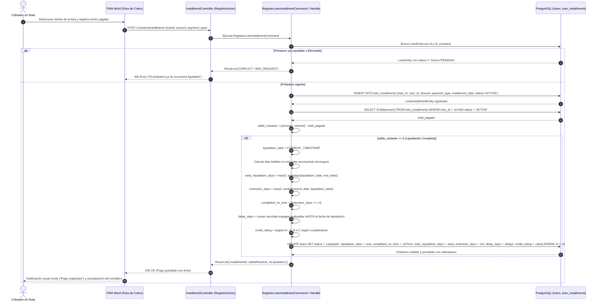

### Reglas de Liquidación Inmediata y Persistencia de Indicadores
1. **Regla de Oro en Préstamos Liquidados:**  
   En préstamos con `status = 'Liquidado'`, los días de retraso (`delay_days`) **solo se computan desde la fecha de liquidación hacia atrás**.  
   *Ejemplo real:* Si un préstamo pactado a 24 días vence el 19/10, pero el prestatario abona el saldo total el 13/10 adelantando 6 días, los días del 14/10 al 19/10 **NO son mora ni retraso**. Se registra `early_liquidation_days = 6`, `extension_days = 0`, `completed_on_time = true` y `credit_rating = 'A+'`.
2. **Cero Consumo de CPU en Vistas:**  
   Al persistir las columnas directamente en `loans` (`completed_on_time`, `early_liquidation_days`, `extension_days`, `delay_days`, `credit_rating`), las pantallas (Detalle de Préstamo, Ficha WhatsApp, Vista Pública Compartida) y los reportes leen los valores en $O(1)$ sin realizar bucles de fechas ni cálculos temporales en tiempo de render. El usuario que liquidó se obtiene directamente del último registro en `loan_installments`.
3. **Reversión Transaccional (`delete-loan-installment`):**  
   Si se elimina o anula el abono que liquidó el crédito, el sistema revierte atómicamente el estado a `'Activo'`, asigna `liquidation_date = NULL`, y restablece las columnas de liquidación a sus valores por defecto (`completed_on_time = false`, `early_liquidation_days = 0`, `extension_days = 0`, `delay_days = 0`, `credit_rating = NULL`).

---

## 4. Generación y Consulta Pública de Ficha de Préstamo (SaaS Link Cifrado)

Permite al cliente final consultar su estado de cuenta en línea mediante un enlace temporal seguro generado por el cobrador, sin requerir usuario ni contraseña.

### Diagrama de Secuencia

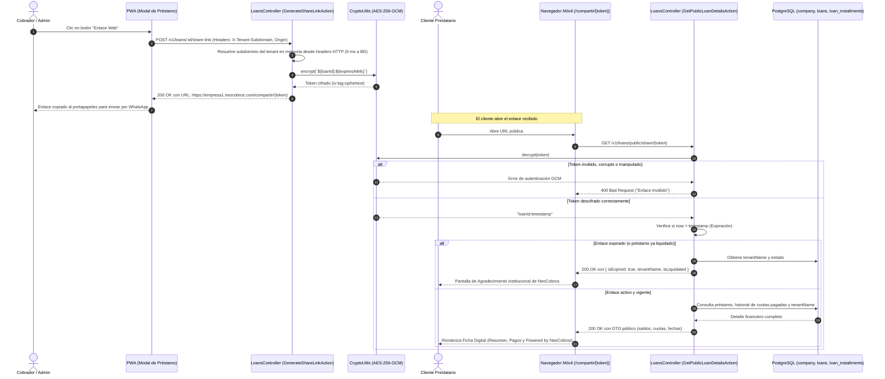

### Reglas de Seguridad y Rendimiento
- **Resolución en Memoria (Zero DB Hit):** El subdominio del tenant se resuelve instantáneamente a partir de las cabeceras HTTP en memoria (`X-Tenant-Subdomain`, `Origin` o `Referer`), eliminando consultas recurrentes a la base de datos PostgreSQL durante la generación del enlace.
- **Cifrado Autenticado (AES-256-GCM):** El enlace codifica `${loanId}:${expiresAtMs}` mediante un vector de inicialización (IV) de 12 bytes y un Authentication Tag de 16 bytes, evitando adulteraciones de datos o ataques de fuerza bruta/enumeración de IDs.
- **Regla de Expiración:** $\text{Expiración} = \max(\text{endDate} + 15\text{ días}, \text{now} + 30\text{ días})$.
- **Privacidad y Estado Liquidado:** Al vencer el plazo o cancelarse la totalidad del crédito, la vista pública no expone montos residuales; en su lugar, presenta una pantalla institucional de agradecimiento del tenant con botón directo de contacto.

---

## 5. Registro de Gastos Operativos de Ruta

Los cobradores declaran los gastos incurridos en su jornada de trabajo (combustible, viáticos, repuestos) directamente desde la calle.

### Diagrama de Secuencia

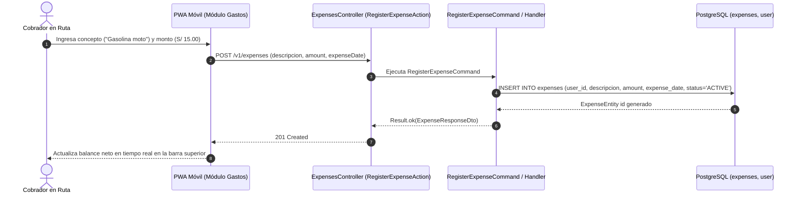

---

## 6. Cierre Diario de Caja y Cuadre de Cobrador

Al finalizar el día de trabajo, el cobrador y el administrador realizan el balance para contrastar el dinero físico recaudado contra los gastos declarados.

### Diagrama de Secuencia

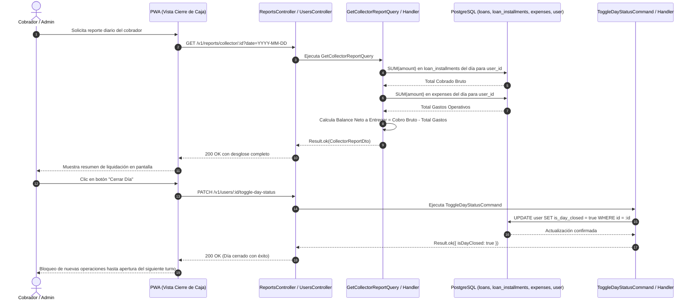

### Reglas de Liquidación y Recaudo Esperado en Domingos
- **Recaudo Esperado Dominical = 0:** La proyección de meta esperada diaria (`expectedAmount`) excluye domingos en la base de datos (`EXTRACT(DOW FROM d.day) != 0`).
- **Cobros Extraordinarios en Domingo:** Si un cliente realiza un pago en domingo (por ejemplo, vía digital o regularización voluntaria), el sistema no le exige meta al cobrador y computa el importe como **cobro extraordinario al 100% de efectividad**.

---

## 7. Reordenamiento Dinámico de la Ruta de Cobranza

Optimiza el recorrido geográfico del cobrador en la calle permitiendo reordenar clientes mediante arrastrar y soltar (Drag and Drop) en la aplicación móvil.

### Diagrama de Secuencia

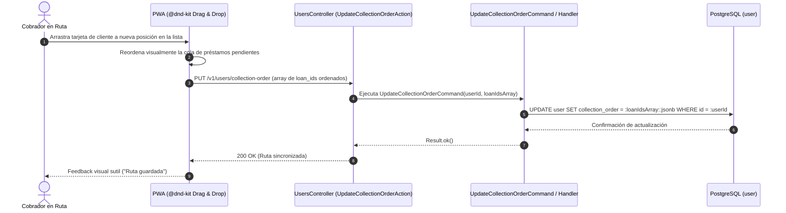

---

## 8. Motor de Central de Riesgos: Doble Ventana de Crons y Recálculo a Demanda (On-Demand)

Gestiona la evaluación integral de la salud crediticia de las personas en el ecosistema NeoCobros. La tabla `people` actúa como una **Central de Riesgos Compartida (Buró Multi-Tenant)**: un prestatario puede tener historial de préstamos en diferentes empresas afiliadas, y su comportamiento consolida un puntaje único (`credit_score` de 0 a 100) junto a su desglose explicativo en `credit_score_detail` (`JSONB`).

El motor está diseñado bajo una arquitectura desacoplada que opera en **dos modalidades de ejecución**:
1. **Modalidad Batch Nocturna (Cierre Masivo de Cartera):** Procesa de forma automatizada a toda la cartera pasiva mediante una doble ventana programada.
2. **Modalidad On-Demand (Bajo Demanda por Cliente):** Permite evaluar a un prestatario individual en tiempo real (< 15 ms) sin esperar al cierre nocturno, exponiendo el endpoint `POST /v1/people/:id/recalculate-score`.

---

### 8.1 Modalidad 1: Doble Ventana de Crons Nocturnos (Batch Masivo)

Para no afectar la transaccionalidad del día ni degradar la base de datos, el procesamiento batch se divide en **dos ventanas nocturnas**:

1. **Ventana 1 (23:00 / 11:00 PM) - Cierre y Evaluación Financiera de Préstamos (`DailyLoansClosingCron`):**  
   A las 11:00 PM las rutas de cobranza ya finalizaron. Este proceso realiza el trabajo financiero pesado sobre la tabla `loans`:
   - **Préstamos Activos:** Compara las cuotas esperadas según días hábiles laborables transcurridos (excluyendo domingos) vs. las cuotas pagadas, y consolida los días de atraso (`delay_days`) al corte de hoy.
   - **Préstamos Liquidados:** Consolida y asegura los días de pago anticipado (`early_liquidation_days`), días de pago fuera de fecha/prórroga (`extension_days`), cumplimiento (`completed_on_time`) y calificación (`credit_rating` `VARCHAR(5)`).
   - **Pre-cálculo de Pilares:** Con todos los préstamos consolidados, pre-calcula los valores métricos de los **3 pilares** correspondientes a cada cliente.
2. **Ventana 2 (01:00 / 1:00 AM) - Actualizador de Scoring Global de Personas (`CreditScoreCronService`):**  
   Dos horas después, este cron actúa como un proceso ultra ágil y liviano:
   - Lee directamente las métricas de los 3 pilares ya precalculadas a las 11:00 PM.
   - Aplica la ponderación matemática global (0 a 100).
   - Actualiza de forma atómica e idempotente el `credit_score` y el `credit_score_detail` en la tabla `people`.
   - **Zero Hit Complejo en Madrugada:** No ejecuta bucles de cuotas ni cálculos de calendario dominical en la madrugada.

#### Diagrama de Secuencia - Modo Batch Nocturno

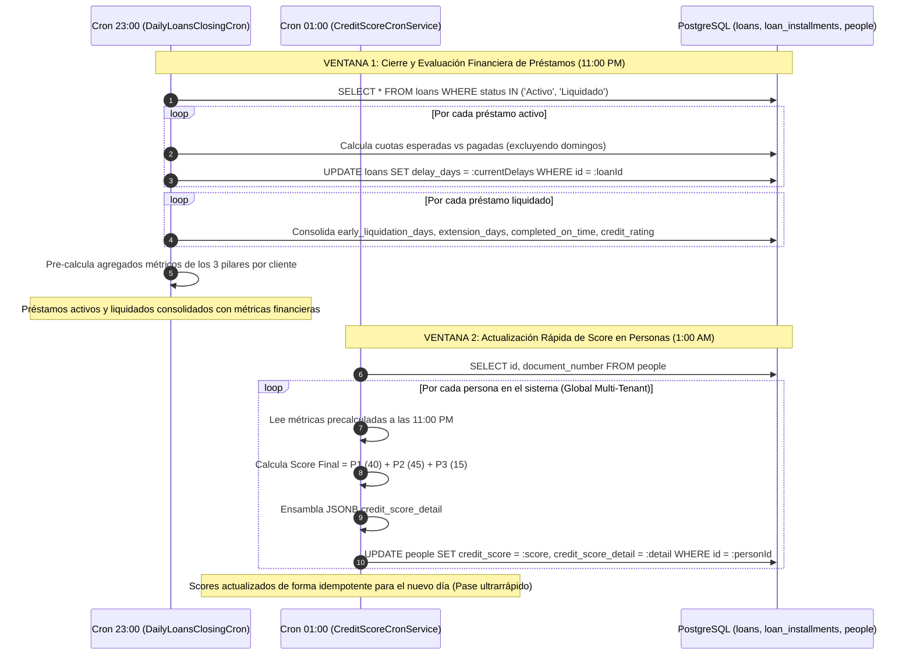

---

### 8.2 Modalidad 2: Recálculo a Demanda para un Cliente (On-Demand)

Permite refrescar en vivo la calificación y el desglose de los 3 pilares de **un solo cliente** en menos de **15 milisegundos**.

- **Casos de Uso Operativos:**
  1. **Evaluación In Situ para Nuevo Crédito:** Un asesor abre la ficha de un cliente que regularizó una cuota atrasada minutos antes; el asesor hace clic en el botón **"Actualizar Score"** y la pantalla muestra de inmediato su calificación restaurada sin esperar a la madrugada.
  2. **Post-Liquidación Inmediata:** Al registrar el abono que liquida un préstamo (`saldo_restante <= 0`), el sistema puede disparar automáticamente el recálculo de la persona para que figure de inmediato con su nuevo crédito liquidado a tiempo (`completed_on_time = true`).

#### Diagrama de Secuencia - Modo On-Demand con Validación de Tenant

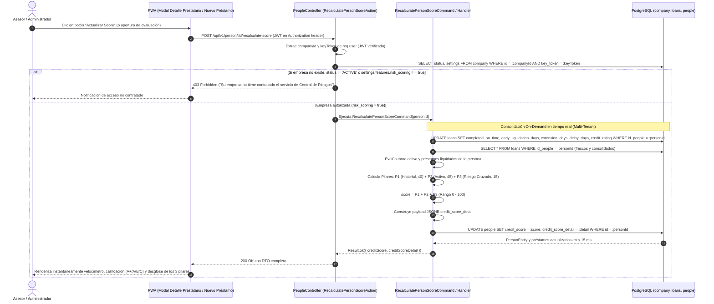

---

### 8.3 Modelo de Calificación en 3 Pilares

$$\text{Puntaje Total (0 - 100)} = \text{Pilar 1 (40 pts)} + \text{Pilar 2 (45 pts)} + \text{Pilar 3 (15 pts)}$$

#### Pilar 1: Reputación Histórica (0 a 40 puntos)
Evalúa el historial de préstamos ya cancelados (`status = 'Liquidado'`). Lee directamente las columnas de `loans`:
- **Crédito Liquidado a Tiempo o Anticipado (`completed_on_time = true`):**
  - Otorga hasta **+10 puntos** por cada préstamo cancelado sin retraso (hasta el tope de 40 pts).
  - Si tiene `early_liquidation_days > 0`, se etiqueta como cancelación anticipada preferente.
- **Crédito Liquidado con Retraso / Prórroga (`extension_days > 0` o `delay_days > 0`):**
  - Prórroga leve (1 a 3 días hábiles): Aporta **+6 puntos** (reconoce que pagó la totalidad de la deuda).
  - Prórroga moderada (4 a 10 días hábiles): Aporta **+3 puntos**.
  - Prórroga severa (> 10 días de prórroga): Aporta **0 puntos** históricos.
- **Cliente Nuevo sin Historial de Liquidados:**
  - Inicia con una base neutral de **25 puntos** en este pilar (permite acceso crediticio inicial).

#### Pilar 2: Puntualidad en Préstamos Activos (0 a 45 puntos)
Mide el cumplimiento diario de los compromisos crediticios actualmente vigentes (`status = 'Activo'`).
- **Al día (0 días de mora):** **45 puntos**.
- **Atraso Leve (1 a 2 días hábiles de mora):** **35 puntos** (-10 pts).
- **Atraso Moderado (3 a 5 días hábiles de mora):** **20 puntos** (-25 pts).
- **Atraso Grave (6 a 12 días hábiles de mora):** **10 puntos** (-35 pts).
- **Mora Crítica (> 12 días hábiles sin pagar):** **0 puntos** en este pilar.
- **Cliente sin Préstamos Activos:** Recibe los **45 puntos** completos de puntualidad activa por ausencia total de morosidad en cartera activa. La descripción cualitativa se adapta transparentemente:
  - *Cliente Nuevo (0 préstamos en total):* `"Sin préstamos activos en curso (no registra deudas pendientes)."`
  - *Cliente Recurrente (con liquidados pero 0 activos hoy):* `"Sin compromisos activos actualmente; créditos previos 100% cancelados."`

#### Pilar 3: Capacidad de Endeudamiento y Riesgo Cruzado Multi-Tenant (0 a 15 puntos)
Analiza la exposición simultánea del cliente en una o más empresas prestamistas afiliadas:
- **1 solo préstamo activo y al día:** **15 puntos** (apalancamiento óptimo).
- **2 préstamos activos y ambos al día:** **12 puntos** (buena capacidad, mayor volumen).
- **3 o más préstamos activos simultáneos al día:** **8 puntos** (alerta por sobreendeudamiento).
- **Mora Cruzada (Préstamo activo en mora en Empresa A mientras opera en Empresa B):** **0 puntos** inmediatos en este pilar (alerta roja de buró).
- **Sin préstamos activos:** Recibe los **15 puntos** completos de capacidad crediticia libre al 100%. La descripción cualitativa indica:
  - *Cliente Nuevo (0 préstamos):* `"Capacidad crediticia 100% disponible (sin endeudamiento previo)."`
  - *Cliente Recurrente (0 activos hoy):* `"Línea de crédito 100% disponible; sin operaciones simultáneas activas."`

---

### Escala de Calificación Crediticia Global

| Rango de Score | Calificación | Categoría de Riesgo | Acción Sugerida |
| :---: | :---: | :---: | :--- |
| **90 - 100** | **A+** | **Excelente / Riesgo Mínimo** | Prestatario estrella. Sujeto de ampliación de monto e interés preferencial. |
| **75 - 89** | **A** | **Bueno / Riesgo Bajo** | Cumplidor regular. Préstamos habituales aprobados. |
| **50 - 74** | **B** | **Regular / Riesgo Medio** | Historial con atrasos o sobreendeudamiento leve. Montos acotados y seguimiento diario. |
| **0 - 49** | **C** | **Crítico / Alto Riesgo** | Mora activa severa o reiterados incumplimientos. Bloqueo de nuevos desembolsos. |

---

### Casos Prácticos de Negocio (Matriz de Simulación Ampliada)

| Caso | Perfil del Prestatario | Pilar 1 (Historial, 40) | Pilar 2 (Activo, 45) | Pilar 3 (Riesgo, 15) | Score Final | Calificación | Diagnóstico del Sistema |
| :--- | :--- | :---: | :---: | :---: | :---: | :---: | :--- |
| **Caso 1: Pepe** | 5 liquidados al día + 1 activo con 3 días de retraso | 40 pts | 20 pts (mora 3d) | 12 pts | **72 pts** | **B (Regular)** | Excelente historial, pero su mora activa actual le descuenta temporalmente 28 pts hasta que se ponga al día. |
| **Caso 2: Juan** | 5 liquidados con atraso pero cancelados + 1 activo al día | 25 pts (pagó con prórroga) | 45 pts (al día) | 15 pts | **85 pts** | **A (Bueno)** | Su puntualidad impecable en el préstamo actual compensa su historial previo de prórrogas. |
| **Caso 3: Luis** | Sin historial previo + 1 activo al día | 25 pts (base nuevo) | 45 pts (al día) | 15 pts | **85 pts** | **A (Bueno)** | Prestatario nuevo con comportamiento impecable. |
| **Caso 4: Alex** | Liquidados previos + 1 al día en Empresa 1 + 1 en mora en Empresa 2 | 35 pts | 10 pts (mora activa) | 0 pts (mora cruzada) | **45 pts** | **C (Crítico)** | La mora cruzada entre distintos tenants enciende la alarma roja del buró y desploma el score. |
| **Caso 5: Carlos** | Sin historial favorable + 1 préstamo activo con >20 días de mora | 0 pts | 0 pts (mora crítica) | 0 pts (incumplimiento) | **0 pts** | **C (Crítico)** | Cliente castigado / moroso incobrable. Bloqueo total para nuevos créditos. |
| **Caso 6: María** | 4 liquidados anticipados (`early_liquidation_days > 0`) + 1 activo al día | 40 pts (VIP) | 45 pts (al día) | 15 pts | **100 pts** | **A+ (Excelente)** | Cliente preferente estrella. Califica para tasas reducidas y ampliación inmediata de límite. |
| **Caso 7: Roberto** | 2 liquidados al día + 3 activos en la misma empresa todos al día | 20 pts | 45 pts (al día) | 8 pts (3 activos) | **73 pts** | **B (Regular)** | Cliente cumplidor pero con alto volumen de endeudamiento simultáneo; se sugiere no otorgar más préstamos concurrentes. |

---

### Detalle de Campos Almacenados en `people.credit_score_detail` (`JSONB`)

Para que el frontend muestre la información al instante sin ejecutar lógica de negocio ni cálculos en tiempo de render, el objeto JSONB consolida la siguiente estructura:

| Campo / Ruta JSON | Tipo de Dato | Descripción y Regla de Negocio |
| :--- | :--- | :--- |
| `calculated_at` | `string (ISO8601)` | Fecha y hora exacta de la última evaluación nocturna (ej. `'2026-10-23T01:00:00.000Z'`). |
| `score` | `number (0-100)` | Puntaje final calculado (idéntico a la columna `people.credit_score`). |
| `rating` | `string (5)` | Calificación alfanumérica (`A+`, `A`, `B`, `C`). |
| `rating_label` | `string` | Etiqueta en español para la UI (`'Excelente'`, `'Bueno'`, `'Regular'`, `'Crítico'`). |
| `summary.total_loans_count` | `number` | Total histórico de préstamos en todas las empresas afiliadas. |
| `summary.liquidated_count` | `number` | Cantidad total de préstamos ya cancelados al 100%. |
| `summary.active_count` | `number` | Cantidad de préstamos vigentes al momento del corte. |
| `summary.active_tenants_count` | `number` | Número de empresas distintas donde el cliente mantiene créditos activos. |
| `summary.has_arrears` | `boolean` | `true` si al menos un crédito activo tiene 1 o más días de mora. |
| `summary.total_debt_amount` | `number` | Saldo monetario total adeudado en todos los créditos activos. |
| `summary.total_paid_amount` | `number` | Importe acumulado histórico amortizado por el cliente. |
| `pillars.reputation_history.score` | `number (0-40)` | Puntos obtenidos en el Pilar 1 (Historial de Liquidados). |
| `pillars.reputation_history.max_score`| `number` | Tope máximo del pilar (`40`). |
| `pillars.reputation_history.weight_percent` | `number` | Peso porcentual del pilar en el score global (`40%`). |
| `pillars.reputation_history.liquidated_on_time_count` | `number` | Cantidad de préstamos cancelados puntualmente dentro o antes del plazo pactado. |
| `pillars.reputation_history.early_liquidated_count` | `number` | Cantidad de préstamos cancelados con días de anticipación (`early_liquidation_days > 0`). |
| `pillars.reputation_history.liquidated_with_extension_count` | `number` | Cantidad de préstamos cancelados con prórroga o días fuera de fecha (`extension_days > 0`). |
| `pillars.reputation_history.avg_delay_days` | `number` | Promedio de días de retraso en los préstamos liquidados. |
| `pillars.reputation_history.is_new_customer` | `boolean` | `true` si el cliente no tiene créditos liquidados previos (aplica base neutral de 25 pts). |
| `pillars.reputation_history.assessment` | `string` | Veredicto textual del pilar para el asesor (ej. `'Historial intachable'`, `'Canceló con prórrogas'`). |
| `pillars.active_punctuality.score` | `number (0-45)` | Puntos obtenidos en el Pilar 2 (Puntualidad en Activos). |
| `pillars.active_punctuality.max_score`| `number` | Tope máximo del pilar (`45`). |
| `pillars.active_punctuality.weight_percent` | `number` | Peso porcentual del pilar en el score global (`45%`). |
| `pillars.active_punctuality.active_delay_days` | `number` | Máximo de días de retraso observado en sus créditos activos al corte de hoy. |
| `pillars.active_punctuality.unpaid_installments_count` | `number` | Número de cuotas vencidas exigibles pendientes de pago hoy. |
| `pillars.active_punctuality.status` | `string` | Estado operativo (`'AL_DIA'`, `'MORA_LEVE'`, `'MORA_MODERADA'`, `'MORA_GRAVE'`, `'MORA_CRITICA'`). |
| `pillars.active_punctuality.assessment` | `string` | Explicación para la UI (ej. `'100% puntual en cuotas vigentes'`, `'Atraso de 3 cuotas'`). |
| `pillars.debt_capacity.score` | `number (0-15)` | Puntos obtenidos en el Pilar 3 (Endeudamiento y Riesgo Cruzado). |
| `pillars.debt_capacity.max_score` | `number` | Tope máximo del pilar (`15`). |
| `pillars.debt_capacity.weight_percent` | `number` | Peso porcentual del pilar en el score global (`15%`). |
| `pillars.debt_capacity.active_loans_count` | `number` | Cantidad de créditos activos simultáneos. |
| `pillars.debt_capacity.active_tenants_count` | `number` | Cantidad de empresas donde tiene créditos activos. |
| `pillars.debt_capacity.has_cross_tenant_arrears` | `boolean` | `true` si tiene mora en un tenant y préstamos activos en otro. |
| `pillars.debt_capacity.status` | `string` | Estado de capacidad (`'OPTIMO'`, `'MODERADO'`, `'SOBRE_ENDEUDADO'`, `'ALERTA_CRUZADA'`). |
| `pillars.debt_capacity.assessment` | `string` | Resumen cualitativo de endeudamiento. |
| `recommendations.status` | `string` | Decisión sugerida (`'APROBADO'`, `'SUJETO_A_CONDICIONES'`, `'BLOQUEADO'`). |
| `recommendations.suggested_action` | `string` | Guía de acción para el analista (ej. `'Apto para renovación estándar'`). |
| `recommendations.risk_level` | `string` | Nivel de riesgo crediticio global (`'MINIMO'`, `'BAJO'`, `'MEDIO'`, `'ALTO'`). |

#### Ejemplo de Carga JSONB:
```json
{
  "calculated_at": "2026-10-23T01:00:00.000Z",
  "score": 85,
  "rating": "A",
  "rating_label": "Bueno / Riesgo Bajo",
  "summary": {
    "total_loans_count": 6,
    "liquidated_count": 5,
    "active_count": 1,
    "active_tenants_count": 1,
    "has_arrears": false,
    "total_debt_amount": 1200.00,
    "total_paid_amount": 7500.00
  },
  "pillars": {
    "reputation_history": {
      "score": 25,
      "max_score": 40,
      "weight_percent": 40,
      "liquidated_on_time_count": 3,
      "early_liquidated_count": 1,
      "liquidated_with_extension_count": 2,
      "avg_delay_days": 1.5,
      "is_new_customer": false,
      "assessment": "Historial positivo con cancelaciones totales"
    },
    "active_punctuality": {
      "score": 45,
      "max_score": 45,
      "weight_percent": 45,
      "active_delay_days": 0,
      "unpaid_installments_count": 0,
      "status": "AL_DIA",
      "assessment": "100% puntual en cuotas vigentes"
    },
    "debt_capacity": {
      "score": 15,
      "max_score": 15,
      "weight_percent": 15,
      "active_loans_count": 1,
      "active_tenants_count": 1,
      "has_cross_tenant_arrears": false,
      "status": "OPTIMO",
      "assessment": "Capacidad de endeudamiento saludable"
    }
  },
  "recommendations": {
    "status": "APROBADO",
    "suggested_action": "Cliente apto para renovación estándar o ampliación controlada de monto.",
    "risk_level": "BAJO"
  }
}
```

### Garantía de Idempotencia y Cero Degradación Acumulativa
A diferencia del diseño anterior (donde un cron restaba puntos ciegamente cada noche `score = score - pen`, pulverizando el historial por un solo atraso), el nuevo motor es **100% idempotente**:
- Cada noche a la 1:00 AM se toma una **fotografía analítica fresca** del estado de la persona.
- Si un cliente en mora regulariza su pago al día siguiente, la siguiente ejecución nocturna restaura automáticamente su puntaje del Pilar 2 a 45 puntos sin requerir intervención manual ni scripts correctivos.

---

## 9. Módulo de Reportes Financieros y Evolución del Capital e Inversión (MoM)

Proporciona a los propietarios y administradores visibilidad patrimonial profunda sobre el capital total colocado, el capital vivo en calle, la utilidad neta real descontando gastos de operación y la velocidad de crecimiento o decrecimiento mensual (MoM).

### Propósito y Métricas Patrimoniales
- **Saldo Total en Calle (Deuda Viva Activa):** Total de dinero pendiente de cobro en la calle de todos los préstamos en estado `Activo`. Coincide exactamente con la métrica de *Saldo Por Cobrar* de la vista de préstamos:
  $$\text{Saldo Total en Calle} = \sum_{\text{activos}} (\text{amount} + \text{interest}) - \sum_{\text{activos}} \text{total\_abonos}$$
- **Desglose Analítico de la Cartera en Calle:**
  1. **Capital Propio Pendiente:** El dinero neto del bolsillo del prestamista que aún no ha retornado:
     $$\text{Capital Propio} = \sum_{\text{activos}} \text{amount} - \sum_{\text{activos}} \left( \text{monto\_cuota} \times \frac{\text{amount}}{\text{amount} + \text{interest}} \right)$$
  2. **Interés Futuro por Cobrar:** Ganancia bruta futura pactada que ingresará con las cuotas pendientes:
     $$\text{Interés Futuro} = \text{Saldo Total en Calle} - \text{Capital Propio Pendiente}$$
- **Ganancia Limpia Acumulada:** Beneficio neto real del negocio que le queda en el bolsillo al dueño, calculado como el interés cobrado acumulado menos todos los gastos operativos de ruta registrados:
  $$\text{Ganancia Limpia} = \text{Intereses Cobrados} - \text{Gastos de Ruta}$$
- **Margen de Ganancia Neta sobre Intereses:** Porcentaje de ganancia limpia retenida por cada S/ 100 cobrados de interés tras cubrir los gastos de ruta:
  $$\text{Margen Neto} = \left( \frac{\text{Ganancia Limpia}}{\text{Intereses Cobrados}} \right) \times 100$$
- **Total Prestado (La Rueda):** Suma total de todos los préstamos otorgados a lo largo del tiempo (rotación continua del capital prestado y vuelto a prestar).
- **Capital Devuelto y Salud del Cobro:**
  $$\text{Porcentaje Cobrado} = \left( \frac{\text{Capital Devuelto a Caja}}{\text{Total Prestado}} \right) \times 100$$
- **Evolución Mensual (MoM - Month over Month):** Generación de serie temporal por mes (`DATE_TRUNC('month', ...)`):
  - **Gráfico Interactivo de Barras:** Ordenado cronológicamente ascendente (de izquierda a derecha: más antiguo $\rightarrow$ más reciente) para visualizar tendencias continuas.
  - **Tabla y Cards de Desglose Mensual:** Ordenadas cronológicamente descendente (del mes actual al más antiguo) para que el prestamista vea primero el mes en curso y baje a los meses pasados.
  - Capital desembolsado en nuevos créditos y cantidad de operaciones colocadas.
  - Capital recuperado (amortización de principal) vs interés cobrado.
  - Gastos operativos del mes declarados por cobradores.
  - Margen neto mensual (intereses - gastos).
  - Tasa de crecimiento MoM de colocación: $\left(\frac{\text{Colocado}_m - \text{Colocado}_{m-1}}{\text{Colocado}_{m-1}}\right) \times 100$.
  - Flujo neto de efectivo mensual: $\text{Recaudo Total} - (\text{Capital Colocado} + \text{Gastos Operativos})$.

### Diagrama de Secuencia

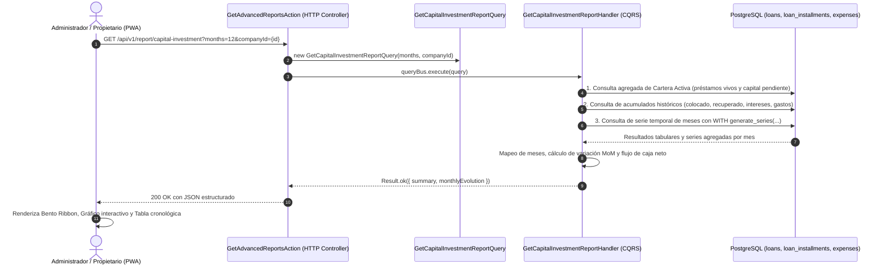

---

## 10. Mantenimiento y Purga Automática de la Empresa Demo (ID 102)

Para prevenir la saturación de almacenamiento, preservar los índices de base de datos y garantizar un rendimiento óptimo en demostraciones públicas y comerciales de **NeoCobros**, la plataforma cuenta con una rutina automatizada y manual de purga periódica para la empresa **DEMO** (`id_company = 102`).

### Reglas de Depuración y Aislamiento
1. **Aislamiento Estricto por Tenant:**
   - La purga se ejecuta **exclusivamente** sobre registros vinculados a la empresa Demo (`id_company = 102`).
   - El resto de empresas SaaS del sistema están totalmente aisladas e inmunes a este proceso.
2. **Criterio de Antigüedad Temporal:**
   - Préstamos creados hace más de **4 días** (`created_at < NOW() - INTERVAL '4 days'`).
   - Se eliminan de forma atómica en cascada sus cuotas (`loan_installments`) y el préstamo (`loans`).
   - Gastos (`expenses`) de usuarios de la empresa Demo registrados hace más de **4 días**.
3. **Auditoría Transaccional:**
   - Toda ejecución (programada o manual) se registra en `cron_executions` bajo el identificador `DEMO_COMPANY_CLEANUP`.
   - Se audita el estado (`SUCCESS` / `FAILED`), duración en milisegundos y métricas de registros eliminados (`loansDeleted`, `installmentsDeleted`, `expensesDeleted`).

### Ejecución
- **Automática (Programada):** Todos los días a las **02:00 AM (02:00 hrs)** mediante `@Cron('0 2 * * *')`.
- **Manual (A Demanda para OWNER):** Desde el panel de administración técnica (`/configuracion/sistema`) mediante `POST /api/v1/owner/cron/run-demo-cleanup`.

### Diagrama de Secuencia

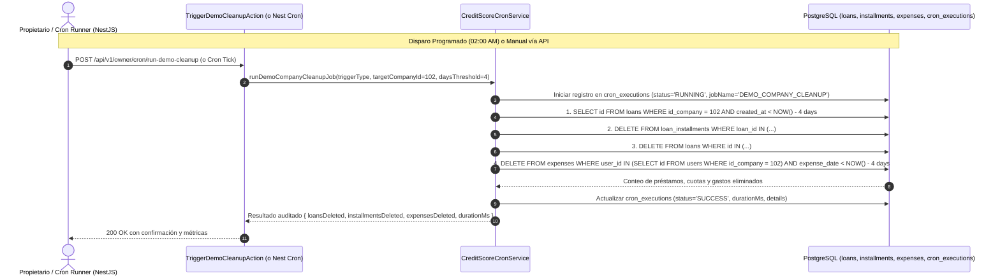

---

## 11. Protección de Usuarios Demo contra Eliminación

Los usuarios con ID `9` y `11` son los accesos públicos de la empresa demo. Se comparten con quienes quieren probar el sistema, que pueden usarlo al 100%. Para que nadie deje sin acceso al resto de visitantes, **estos usuarios no pueden eliminarse (desactivarse)**.

- **Backend:** `DeleteUserHandler` tiene la constante `PROTECTED_USER_IDS = ['9', '11']`. Antes de consultar la BD devuelve `Result.err('PROTECTED_USER_CANNOT_BE_DELETED')`, que responde **403 / `USR_008`**.
- **Frontend:** en `cobradores/page.tsx` el `ConfirmModal` se abre con `confirmDisabled` y un mensaje informativo. `executeAction` tampoco llama al endpoint para esos IDs.

> Para agregar o quitar usuarios protegidos hay que actualizar `PROTECTED_USER_IDS` en **ambos** proyectos.

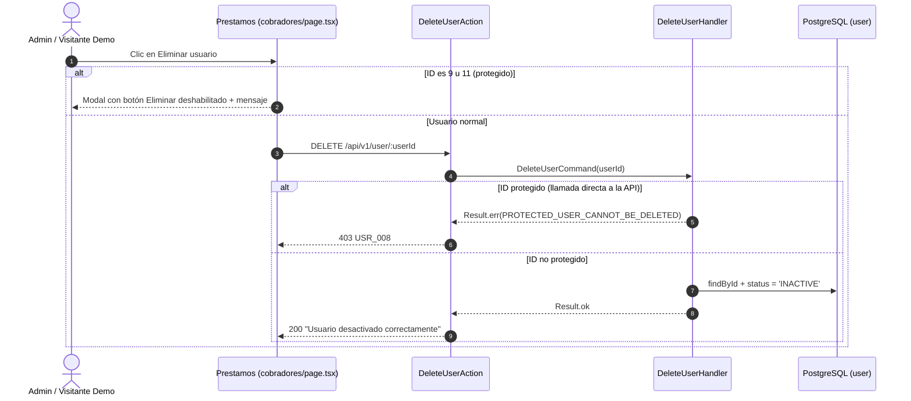

---

## Resumen de Interacciones de Datos por Proceso

| Flujo de Negocio | Entidades Modificadas | Entidades Consultadas | Acciones Críticas |
| :--- | :--- | :--- | :--- |
| **1. SaaS Login** | - | `company`, `user`, `people` | Validación de tenant por subdomain, JWT con `fgp`. |
| **2. Otorgamiento** | `people` (opcional), `loans`, `user` | `people`, `company`, `user` | Cálculo de cuota (`fee`), inserción en `collection_order`. |
| **3. Abono de Cuota** | `loan_installments`, `loans` | `loans`, `loan_installments` | Acumulador de pagos, liquidación automática si saldo $\le 0$, cálculo y sellado de indicadores de mora/anticipación en `loans`. |
| **4. Enlace Ficha** | - | `loans` (Generación) / `loans`, `company`, `loan_installments` (Consulta) | Subdominio en memoria (0 DB hit al generar), Token AES-256-GCM y pantalla de agradecimiento. |
| **5. Gastos** | `expenses` | `user` | Declaración de egresos con deducción de saldo en caja. |
| **6. Cierre de Día** | `user` (`is_day_closed`) | `loan_installments`, `expenses` | Balance neto = Bruto - Gastos, bloqueo de operaciones. |
| **7. Reordenar Ruta** | `user` (`collection_order`) | `user`, `loans` | Persistencia de array JSONB de préstamos en secuencia óptima. |
| **8. Central de Riesgos** | `loans` (Cierre 11 PM), `people` (`credit_score`, `detail`) | `loans`, `people` | Doble ventana de crons nocturnos (Cierre 11 PM + Score 1 AM) y recálculo a demanda On-Demand (`POST /v1/people/:id/recalculate-score` en < 15 ms). |
| **9. Capital e Inversión** | - | `loans`, `loan_installments`, `expenses` | Agregación de cartera activa, ROI acumulado, serie cronológica mensual y variación porcentual MoM. |
| **10. Purga Entorno Demo** | `loans`, `loan_installments`, `expenses`, `cron_executions` | `loans`, `users` | Eliminación atómica segura de registros > 4 días de antigüedad exclusiva para la empresa 102 a las 02:00 AM o a demanda. |
| **11. Usuarios Demo Protegidos** | - | - | IDs `9` y `11` bloqueados en `DELETE /api/v1/user/:userId` (403 `USR_008`) y modal deshabilitado en el frontend. |

